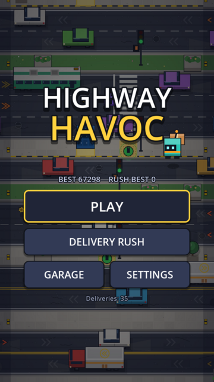
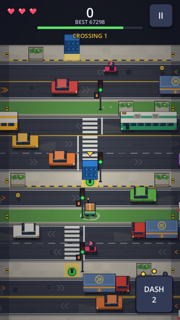
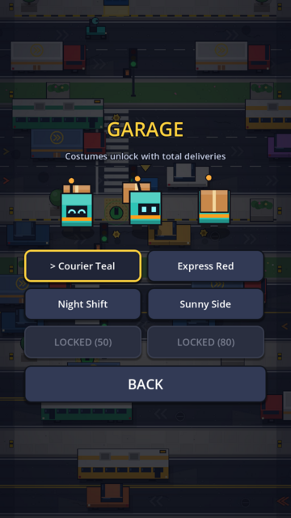
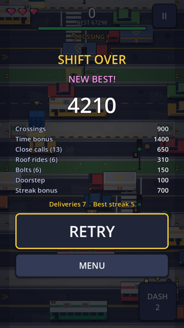
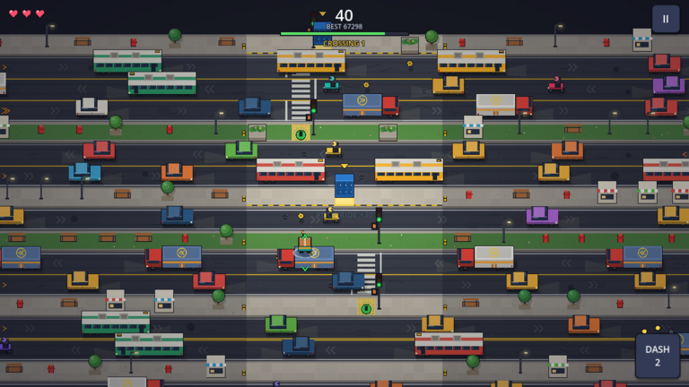

# Highway Havoc

A lane-crossing arcade game. You play a small, overconfident delivery robot carrying parcels across busy downtown streets. Built with **Godot 4.3** (GDScript, GL Compatibility renderer) for Android phones (portrait) and the Retroid Pocket 5 (landscape, gamepad).

This repository is the **first playable milestone** from the design document: one polished Downtown district with endless, validated crossings.

<p>
   
</p>


## What's in the milestone

| Design requirement | Where it lives |
|---|---|
| Robot with four-way hops, squash/stretch, landing dust, reactions (blink, worried, happy, dazed) | `scripts/game/player_hop_controller.gd`, `scripts/game/art.gd` |
| Swipe / tap / optional hold-edge controls with swipe buffering; D-pad, stick and keyboard with hold-repeat | `scripts/game/input_router.gd` |
| Sidewalks, traffic lanes and safe medians (6–10 rows per crossing) | `scripts/core/road_generator.gd` |
| Four vehicle types (car, motorcycle, bus, delivery truck), each lane at its own speed, hitboxes match what you see | `scripts/core/vehicle_types.gd`, `scripts/core/lane_sim.gd` |
| Push-button **traffic light** with a visible warning delay | `scripts/core/traffic_light.gd` |
| **Rideable truck roofs** with a landing marker, safe-exit arrows and an edge warning | `player_hop_controller.gd`, `hazard_telegraph.gd` |
| Three lives (Hardcore: one), near-miss scoring with a per-vehicle cap, parcel-streak multiplier, saved high score | `scripts/core/score_and_streak.gd`, `scripts/autoload/game_state.gd` |
| Pause / Restart / Quit, results screen with breakdown and a large Retry button | `scripts/ui/main.gd` |
| City dressing, road texture, shadows, animated signals and lamps, particles, skid marks, camera shake, hit-stop | `row_ground.gd`, `row_view.gd`, `fx_pool.gd` |
| Five curated lane templates, picked at random and re-rolled until they pass fairness validation | `RoadGenerator.TEMPLATES` |
| Delivery Rush: a daily-seed course of 5 crossings in 100 s with one objective | `game.gd` (`mode == "rush"`) |
| Garage: six robot colour schemes, unlocked by total deliveries (no paid or grind-only advantages) | `GameState.PALETTES` |

Not in this milestone, as the design document asks: pileups, rain/Storm Night, the rail yard and the other districts, larger unlock trees, and online leaderboards.

## How to play

* **Touch controls** — three schemes, switch any time in Settings → *Touch* (also reachable from the pause menu):
  * **Swipe** (default): swipe to hop one cell, tap hops forward. A quick second swipe is queued and runs when you land. Short flicks count as swipes, never as a forward tap.
  * **Tap toward robot**: touch anywhere and the robot hops in whichever of the four directions is closest to your finger, measured from the robot (far left of the screen → left, below the robot → down; a lower-left touch picks left or down, whichever is larger). Hold to keep hopping; it stops once the robot reaches your finger. A ring and arrow show the hop it picked.
  * **On-screen D-pad**: a large translucent D-pad under your steering thumb (right side, or left with Left-handed layout on) with Dash on the other side. Press to hop, hold to repeat, slide between arms to change direction. The camera sits a little higher so the pad doesn't cover the lane behind you.
* **DASH** (button, gamepad A, Space) leaps two cells. You start with 2 charges, gain one per delivery and one for every 3 bolts, up to 3. Dashing skips the middle row, but the landing row is still checked.
* Step onto the **green hand pad** at the foot of a crosswalk. The light turns amber, then red. The walking figure (and a white countdown ring) appears only once the crosswalk is actually clear. A flashing orange hand means traffic is about to move again.
* Land on the **yellow-ringed cargo roof** of a delivery truck to ride it for bonus points. Green and red arrows above and below the robot show whether hopping off right now is safe. The pad flashes red when the truck is about to carry you off the playfield. **B / Shift** steps off backwards.
* Orange chevrons at the screen edge warn about vehicles that are about to arrive. Their size shows the vehicle size.
* Reach the far sidewalk to deliver. Landing on the glowing **doorstep** in front of the blue locker earns a bonus.

**Gamepad:** D-pad or left stick to hop (one hop per press, no diagonals), A dash, B step off a roof, Start pause. **Keyboard:** arrows/WASD, Space, Shift, Esc/P.

### Scoring
`crossing points + time left × tempo bonus + doorstep`, multiplied by the parcel streak (×1, ×1.5, … up to ×4), plus near misses (+50, once per vehicle, at most 8 per crossing), roof rides (+30 plus distance) and bolts (+25). Getting hit resets the streak.

## Fairness: how it's enforced

The design's core rule is *"the player always understands what killed them."* These pieces back it up:

1. **One simulation for everything.** `LaneSim` is pure logic. The live game, the validator and the tests all run the same code, so what the validator predicts is the traffic the player actually gets.
2. **Spacing rules.** Vehicles in a lane are never closer than 1.0 s *and* 150 px. Spawn positions are tied to the previous vehicle, so spacing doesn't depend on frame rate.
3. **SafePathValidator.** Every generated crossing is searched for a path that works with *human* timing: decisions every 0.15 s (slower than a hop), every hitbox widened by 14 px on each end, truck roofs treated as deadly, and the crosswalk button never pressed. A path must exist from **five different start times**. Crossings that fail are re-rolled, then traffic is eased off. At most 4 lanes may come before a refuge row.
4. **Honest collisions.** A hit happens only when the 40×36 robot box overlaps a vehicle box on the row the robot is in. Hop height and animation never count.
5. **The signal never lies.** WALK starts only after the crosswalk is physically empty. Each car decides at amber, using braking physics, whether it can stop.

## Tests (run headless)

```bash
# Logic: lane spacing, signal safety, 150 generated segments across 5 difficulty levels, validator negatives, determinism, scoring
godot --headless --path . -s tests/run_tests.gd

# End-to-end: a cautious bot plays the real Game scene (input, collisions, signals, deliveries,
# background generation), then a reckless phase covers death, respawn, game over and restart
godot --headless --path . --fixed-fps 60 res://tests/bot_playtest.tscn

# Touch controls: injects real touch events in all three touch modes and checks the hops produced
godot --headless --path . --fixed-fps 60 res://tests/touch_test.tscn
```

Results from the build machine (Godot 4.3, Linux):

* `run_tests.gd`: **315 checks, 0 failures.** Worst lane gap 1.00 s. 238 signal cycles with 0 frames where WALK showed while a vehicle was in the crosswalk. 150/150 segments validated.
* `bot_playtest.tscn`: 240 s simulated. The careful phase made 30+ deliveries with no deaths (32–35 across runs; each run uses a random seed). The reckless phase triggered about 28 deaths and 9 game-over/restart cycles. **PASS.**

* `touch_test.tscn`: **17 checks, 0 failures**, both headless and in a real 720×1280 window under Xvfb.

What hasn't been checked: the game has **not been run on a physical Android phone or a Retroid Pocket 5**. Touch input, safe areas and real-device performance still need a pass on hardware. Screenshots were rendered under Xvfb with Mesa's software OpenGL.

## Building the Android APK

A debug APK (arm64-v8a and armeabi-v7a, about 49 MB) was built and signature-checked (`apksigner verify`: v1, v2 and v3 OK) on the build machine. Release signing is yours to set up.

**Locally:**
1. Install Godot 4.3 and its export templates (Editor → Manage Export Templates).
2. Install a JDK 17+ and the Android SDK (build-tools, platform-tools). Set both paths under Editor Settings → Export → Android, along with a debug keystore:
   `keytool -genkeypair -keystore debug.keystore -storepass android -alias androiddebugkey -keypass android -keyalg RSA -validity 10000 -dname "CN=Android Debug,O=Android,C=US"`
3. Project → Export → **Android** → Export Project, or from the command line:
   `godot --headless --path . --export-debug "Android" build/HighwayHavoc.apk`
4. `adb install build/HighwayHavoc.apk`

For a release build, create a release keystore and fill in `keystore/release*` in the export dialog. Keep the keystore out of git; `.gitignore` already excludes `*.keystore`.

**CI:** `.github/workflows/android.yml` installs Godot, runs both test suites, exports a debug APK and uploads it as the `HighwayHavoc-apk` artifact.

## Project layout

```
scripts/core/      pure logic: constants, LaneSim, TrafficLight, RoadGenerator, SafePathValidator, ScoreAndStreak
scripts/game/      Game (lane manager), PlayerHopController, InputRouter, CameraRig, FXPool, HazardTelegraph, Art, row renderers
scripts/ui/        app shell & menus, HUD, theme
scripts/autoload/  GameState (settings/save/input map), Audio
assets/audio/      generated .wav files (source: tools/gen_audio.py)
tests/             headless logic tests and bot playtest
tools/             audio generator, screenshot helper
```

**Original assets.** All art is drawn in code with Godot's drawing calls (`scripts/game/art.gd` and the row renderers), so there are no image files to edit. All sound and the music loop come from `tools/gen_audio.py` (`python3 tools/gen_audio.py`, requires numpy). The icon is `icon.svg`.

**Settings.** Music and SFX volume, screen-shake strength, hold-repeat delay, effects quality (Low/Medium/High), reduced flashing, high-contrast outlines, left-handed layout, touch scheme, hold-edge hopping, double-tap dash, Hardcore and a 30 FPS battery saver. Everything is stored offline in `user://save.cfg`; no account or internet is needed.

**Seeds.** Each crossing is fully defined by `(run seed, segment index, level, template)`, so a segment can be reproduced from those values when reporting a bug. Delivery Rush uses a seed derived from the date.
